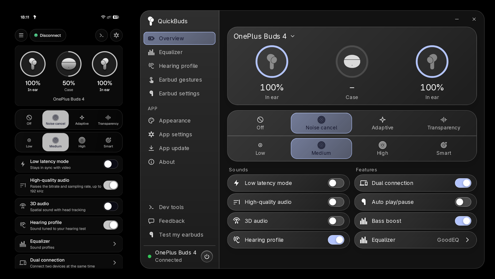
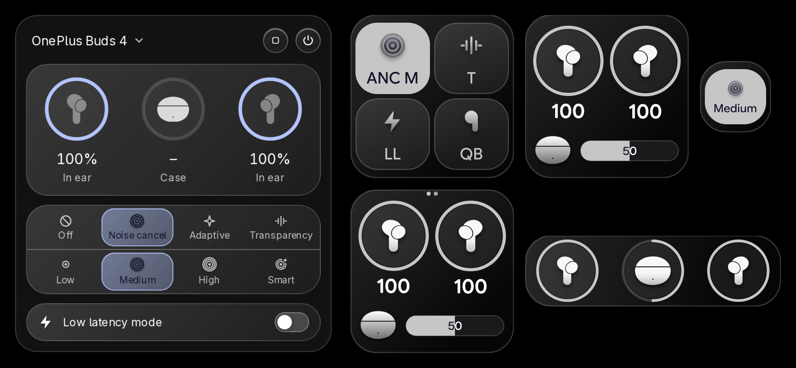

<div align="center">

# QuickBuds

**An alternative to HeyMelody and realme Link for your OnePlus, OPPO and realme earbuds.**

Android · Windows · Linux

[](./LICENSE)
[](#install)
[](https://github.com/spizganed/QuickBuds/releases/latest)
[](https://ko-fi.com/spizganed)
[](https://discord.gg/pvsnEf9TrZ)





</div>

QuickBuds is an open-source app for OnePlus, OPPO and realme earbuds. It replaces HeyMelody and realme Link.
It shows only the controls your model has. The phone has home screen widgets and Quick Settings tiles.
The PC has a tray icon. It is a hobby project. You can support it on [Ko-fi](https://ko-fi.com/spizganed).

## Install

Pair your earbuds in the system's Bluetooth settings first. QuickBuds connects to paired earbuds. It does not pair them.

- **Android 8 or later:** install `QuickBuds<version>.apk` from the [latest release](https://github.com/spizganed/QuickBuds/releases/latest). Allow the Bluetooth permission when the app asks.
- **Windows 10 or 11:** unzip `QuickBuds<version>-windows-x64.zip` from the [latest release](https://github.com/spizganed/QuickBuds/releases/latest) and run `quickbuds.exe`. It needs no installer.
- **Linux:** run this command. It needs `curl` and BlueZ, and no administrator rights.

  ```sh
  curl -fsSL https://raw.githubusercontent.com/spizganed/QuickBuds/main/scripts/install-linux.sh | sh
  ```

  Other ways and how to remove it: [INSTALL-LINUX.md](./docs/INSTALL-LINUX.md).

The apps update themselves from the GitHub releases. The GitHub releases are the only official downloads.
An APK from another site is genuine only with this signing certificate (SHA-256, see `apksigner verify --print-certs`):
`9ae0ea888079cbd86af5a24391cd351af4a81fc04ebe9bd8429074c736249f61`

## Supported earbuds

QuickBuds knows all 140 models of the HeyMelody and realme Link lists. Owners confirmed 46 of them.
It works on any Android phone, not only on OnePlus, OPPO and realme phones.
The full list: [MODELS.md](./docs/MODELS.md).

## Features

Battery and wear, noise control, equalizer, high-quality audio, 3D audio, low latency, gestures, dual connection,
find my earbuds, hearing test and fit test. Widgets, tiles and a battery notification on the phone. A tray panel on the PC.
Four styles, many themes, 27 languages. All of it: [FEATURES.md](./docs/FEATURES.md).

## Help and reports

- Something does not work? Send a report from Settings › Feedback. No GitHub account is needed.
- A feature is missing? Only a Bluetooth snoop log of the vendor app can add it. How: [REPORTING.md](./docs/REPORTING.md).
- Talk to the developer and other owners on [Discord](https://discord.gg/pvsnEf9TrZ).

## Privacy

Once a day, the app sends its platform, its version and a random install ID. The app sends no earbud data.
Details and how to turn it off: [PRIVACY.md](./docs/PRIVACY.md).

## For developers

- [CONTRIBUTING.md](./docs/CONTRIBUTING.md): build, tests, translations and the rules.
- [PROTOCOL.md](./docs/PROTOCOL.md): the wire format, each claim with its source.
- [ROADMAP.md](./docs/ROADMAP.md): the plan, the ideas and the features decided against.
- [PACKET-CAPTURE.md](./docs/PACKET-CAPTURE.md): how to capture the earbuds' traffic.

Everything to build and release QuickBuds is in this repository, except the signing key.

## Credits

The first protocol hints came from [OppoPodsManager](https://github.com/Zhaoyi-ya/OppoPodsManager),
[Pods-Protocol-Reverse-Engineering](https://github.com/Star-ZER0/Pods-Protocol-Reverse-Engineering) and
[OppoPods](https://github.com/Leaf-lsgtky/OppoPods). Today each fact in PROTOCOL.md rests on a capture, a device test
or the vendor apps, studied for interoperability only. The PC app uses [Tauri](https://tauri.app) and
[tray-icon](https://github.com/tauri-apps/tray-icon). Fonts: [Doto](https://github.com/oliverlalan/Doto) and
[Google Sans Flex](https://github.com/googlefonts/googlesans-flex) (SIL Open Font License 1.1).

## License

Copyright (C) 2026 spizganed

QuickBuds has two licences:

- **Open source:** the GNU General Public License v3.0 or later. Everyone can use, study, change and share
  QuickBuds under this licence. It has no warranty. See [LICENSE](./LICENSE).
- **Commercial:** the copyright holder can license QuickBuds under other terms, for example for a company
  that wants to build it into a closed-source product. To ask, open an issue on GitHub.

Contributors keep the copyright of their work. They license it under both terms in the
[Contributor License Agreement](./docs/CLA.md). The public source stays under the GPL.

QuickBuds is an independent project. It is not affiliated with OnePlus, OPPO, realme, HeyTap or their
affiliates. Those companies do not endorse or sponsor it. OnePlus, OPPO, realme, HeyMelody and the earbud
model names are trademarks of their owners. This text uses them only to say which devices the app works
with. The project studied the protocol only to make these earbuds work with this app.

## Star History

<a href="https://www.star-history.com/?repos=spizganed%2Fquickbuds&type=date&legend=top-left">
 <picture>
   <source media="(prefers-color-scheme: dark)" srcset="https://api.star-history.com/chart?repos=spizganed/quickbuds&type=date&theme=dark&legend=top-left" />
   <source media="(prefers-color-scheme: light)" srcset="https://api.star-history.com/chart?repos=spizganed/quickbuds&type=date&legend=top-left" />
   
 </picture>
</a>
